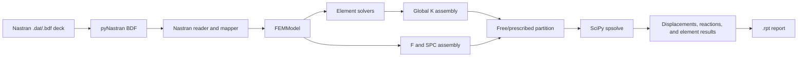

# Architecture

## Overview

The design separates Nastran input handling, the format-independent physical
model, element formulations, global solution, and report presentation. This
separation makes it possible to add another input format or reporting backend
without coupling it to element mechanics.



## Repository structure

```text
MEF-solver/
├── main.py                         command-line entry point and orchestration
├── input/                          user models, ignored by Git
├── output/                         generated reports, ignored by Git
├── src/
│   ├── preprocessing/
│   │   ├── data_model.py           format-independent entities
│   │   └── nastran_reader.py       pyNastran -> FEMModel adapter
│   ├── solver/
│   │   ├── linear_static_solver.py assembly, boundary conditions, solution,
│   │   │                           and numerical result recovery
│   │   ├── nonlinear_analysis.py   increments, Newton iterations, tangent,
│   │   │                           and CROD/CBAR residuals
│   │   ├── transformations.py      local systems and transformation matrices
│   │   ├── quadrature.py           one-dimensional Gauss-Legendre rules
│   │   ├── utilities.py            node/degree-of-freedom mapping
│   │   └── elements/               linear and nonlinear element formulations
│   └── postprocessing/
│       └── report_writer.py        result-report presentation
└── tests/
    ├── preprocessing_tst/
    ├── solver_tst/
    │   ├── elements/
    │   └── validation_cases/        decks, F06/PCH output, and Nastran matrices
    └── postprocessing_tst/          report-format contract
```

Files named `draft_*` and the complete `output/` directory are local
artifacts and are not part of the execution path or the repository source of
truth.

## Data model

[`data_model.py`](../src/preprocessing/data_model.py) defines objects that do
not depend directly on pyNastran:

- `Node`: user ID, original `GRID` coordinates, basic Cartesian coordinates,
  output coordinate-system ID, permanent constraints, and the `GRID.CD`
  transformation;
- `IsotropicMaterial`: `E`, `G`, `nu`, `rho`, and completion of a missing
  elastic constant from the other two;
- `RodProperty`, `BarProperty`, and `ShellProperty`;
- `RodElement`, `BarElement`, `CTRIA3Element`, and `CQUAD4Element`;
- nodal `SinglePointLoad` and `SinglePointMoment` objects;
- `SPCConstraint`;
- `FEMModel`, which owns the entity dictionaries and normalized load and
  constraint lists;
- `FEMModel.source_entry_counts`, which retains logical Bulk Data counts for
  the F06-like report independently of normalized loads and constraints;
- `AnalysisConfiguration` and `NonlinearStepControl`, which carry `SOL
  101/400`, `LGDISP`, `FOLLOWK`, and normalized incremental controls without a
  pyNastran dependency.

Materials, properties, nodes, and elements are indexed by their user IDs.
Loads and constraints are lists because repeated set IDs are valid and must
not overwrite one another.

## Preprocessing

[`nastran_reader.py`](../src/preprocessing/nastran_reader.py) reads with
pyNastran validation and cross-referencing enabled. It first attempts to read
a complete deck. If the Executive and Case Control sections are absent, it
retries as a Bulk Data-only punch file.

Complete decks are accepted only for linear `SOL 101` or nonlinear-static
`SOL 400` with `ANALYSIS=NLSTAT`. Unsupported sequences and inconsistent
`SOL`/`ANALYSIS` pairs fail during mapping, before a solver is selected.

Entities are mapped in this order:

1. materials;
2. properties;
3. nodes;
4. elements;
5. loads;
6. constraints.

`GRID.CP` positions are converted to the basic Cartesian frame through
`node.get_position()`. `FORCE` and `MOMENT` vectors defined in another `CID`
are likewise transformed to the basic frame before they enter `FEMModel`.
The reader selects one `SUBCASE` and reduces the associated nested `LOAD`,
`SPCADD`, `SPC`, and `SPC1` sets.

The reader follows a fail-fast policy for unsupported structural entities. It
does not silently omit elements, loads, or constraints, because doing so
would produce an apparently successful model with missing physics.

pyNastran 1.4.1 preserves but does not instantiate MSC `NLSTEP` and `PBARN1`
cards used by this project. The adapter parses those rejected lines
explicitly. For `NLSTEP`, the supported mechanical subset is `GENERAL`,
`FIXED` or `ADAPT`, and `MECH`. For `PBARN1`, the mapped extension retains
`SECT`, `BEH2`, and `INT2` on `BarProperty`. Unsupported continuations fail
explicitly. Comments are removed before identifying a rejected card because
pyNastran may group a preceding comment with that card.

## Degree-of-freedom numbering

[`DofMapper`](../src/solver/utilities.py) sorts node IDs and assigns six
consecutive degrees of freedom to every node:

| Nastran component | Local index | Quantity |
|---:|---:|---|
| 1 | 0 | `Tx` |
| 2 | 1 | `Ty` |
| 3 | 2 | `Tz` |
| 4 | 3 | `Rx` |
| 5 | 4 | `Ry` |
| 6 | 5 | `Rz` |

For the internal node position `i`, the first global index is `6*i`. The
ordering is deterministic and does not depend on card order in the input
file.

## Linear assembly and solution

[`LinearStaticSolver`](../src/solver/linear_static_solver.py) creates
`K_global` as a SciPy LIL sparse matrix, which supports incremental insertion,
and `F_global` as a dense NumPy vector.

Each element supplies a matrix in basic coordinates. The global assembler
collects the six indices of each element node, transforms the element matrix
to the `GRID.CD` degree-of-freedom frames, and adds its coefficients to
`K_global`. Assembly currently uses nested Python loops. This is clear and
adequate for the validated model sizes, but vectorized COO triplets remain a
documented scalability improvement.

Prescribed degrees of freedom `s` and free degrees of freedom `f` give:

```text
K_ff u_f + K_fs u_s = F_f
u_f = solve(K_ff, F_f - K_fs u_s)
```

The matrix is converted to CSC before partitioning and solution.
`MatrixRankWarning` is promoted to an exception, free zero-stiffness rows are
reported, and non-finite input or output is rejected. Reactions are then
computed from the unmodified assembled system:

```text
R = K u - F
```

There is no general `AUTOSPC`. A genuine mechanism or an unconstrained active
degree of freedom must fail rather than be stabilized silently.

## Nonlinear route boundary

The linear solver is not reused implicitly for `SOL 400`. `main.py` inspects
`FEMModel.analysis` and instantiates the sibling `NonlinearStaticSolver`.
That solver shares `DofMapper`, the data model, and coordinate conventions,
but owns incremental state, residuals, tangent assembly, cutbacks,
convergence, and result recovery.

At each Newton iteration it assembles:

```text
r = lambda F_ext - F_int(u)
K_T(u) Delta_u = r
u <- u + Delta_u
```

`CRODNonlinear` and `CBARNonlinear` return internal force, tangent, and physical
state in basic coordinates through a common contract. The global assembler
then transforms vectors and matrices into each `GRID.CD` frame, as in the
linear path. Accepted states are stored in `NonlinearIncrementResult`; Newton
residuals and corrections are stored in `NonlinearIterationResult`.

## Coordinate transformations

[`CoordinateTransformation`](../src/solver/transformations.py) constructs a
matrix `R` whose rows are local unit axes expressed in basic coordinates:

```text
v_local = R v_basic
K_basic = T.T K_local T
```

`T` repeats `R` in translation and rotation blocks for every element node.
CROD and CBAR use the line between their two nodes as local `x`. Shells build
a right-handed triad from their geometry.

The full transformation order is significant:

1. `GRID.CP` positions and load `CID` vectors are converted to the basic
   frame during preprocessing;
2. element formulations produce matrices and forces in the basic frame;
3. assembly converts those quantities to nodal `GRID.CD` frames;
4. result recovery converts solved nodal values back to the basic frame;
5. each element then applies its own local axes.

## Numerical recovery and report presentation

Each element solver owns numerical recovery:

- CROD: axial strain/stress and force, twist per unit length, torque, and
  torsional stress;
- CBAR: axial/torsional response, end forces and moments, and normal and
  torsional stresses at PBAR recovery points; the nonlinear state additionally
  includes current length, element strain energy, and extreme normal stresses
  over both ends;
- CTRIA3: membrane stresses/resultants, moments, transverse shear forces, and
  top/bottom fiber stresses;
- CQUAD4: membrane resultants, moments, transverse shear forces, top/bottom
  fiber stresses, principal values, and von Mises values.

Presentation is isolated in
[`report_writer.py`](../src/postprocessing/report_writer.py). It writes the
model summary, identifies linear or nonlinear static analysis, and presents
configuration without depending on the original input format. For `SOL 400`
it adds the normalized step control, convergence summary, one row per accepted
increment, and one row per Newton correction after the final state.

Final tables are grouped by element family. CBAR output separates
axial/torsional measures, converged nonlinear geometry and energy, end A/B
actions, and C--F recovery-point stresses. The nonlinear state table appears
only when `current_length` and `strain_energy` exist, so a linear result does
not receive artificial zeros. Internal keys `P0`--`P3` are displayed as
Nastran points C--F. Shell resultants `N/M/Q` and top/bottom fiber stresses are
shown in separate tables, following an F06-like organization.

Column definitions and F06 correspondences are documented in
[`result_report.md`](result_report.md).
