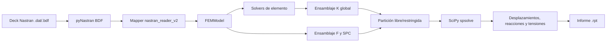

# Arquitectura

## Visión general

El diseño separa la entrada Nastran del modelo físico y de las formulaciones de elemento. Esa separación es una buena base para incorporar otros formatos de entrada o un postprocesador independiente.



## Estructura del repositorio

```text
MEF-solver/
├── main.py                         entrada de línea de comandos y orquestación
├── input/                          modelos de usuario
├── output/                         informes generados (ignorado por Git)
├── src/
│   ├── preprocessing/
│   │   ├── data_model.py           entidades independientes del formato
│   │   ├── nastran_reader_v2.py    adaptación pyNastran -> FEMModel
│   │   └── deprecated/             lector manual y pruebas antiguas
│   ├── solver/
│   │   ├── linear_static_solver.py ensamblaje, contorno, solución y resultados
│   │   ├── transformations.py      sistemas locales y matrices T
│   │   ├── quadrature.py           reglas de Gauss-Legendre 1D
│   │   ├── utilities.py            mapeo nodo/GDL
│   │   └── elements/               CROD, CBAR, CTRIA3 y CQUAD4
│   └── postprocessing/
│       └── report_writer.py        escritor del informe de resultados
└── tests/
    ├── preprocessing_tst/
    ├── solver_tst/
    │   ├── elements/
    │   └── validation_cases/        decks, F06, PCH y matrices CSV Nastran
    └── postprocessing_tst/          validación del formato de salida
```

Los ficheros `draft_*` están ignorados por Git y no forman parte del camino de ejecución. `rod_element.py` es una implementación anterior; el solver global usa `RodElementSolverV2` de `rod_element_v2.py`.

## Modelo de datos

[`data_model.py`](../src/preprocessing/data_model.py) define objetos sin dependencia directa de pyNastran:

- `Node`: ID, coordenadas de entrada y coordenadas cartesianas globales.
- `IsotropicMaterial`: `E`, `G`, `nu`, `rho` y cierre automático de constantes elásticas.
- propiedades `RodProperty`, `BarProperty` y `ShellProperty`.
- elementos `RodElement`, `BarElement`, `CTRIA3Element` y `CQUAD4Element`.
- cargas nodales `SinglePointLoad` y `SinglePointMoment`.
- restricciones `SPCConstraint`.
- `FEMModel`: diccionarios de entidades y listas de cargas/restricciones.

Materiales, propiedades, nodos y elementos se indexan por el ID de usuario. Las cargas y restricciones se guardan en listas para permitir SIDs repetidos.

## Preproceso

[`nastran_reader_v2.py`](../src/preprocessing/nastran_reader_v2.py) usa pyNastran con validación y *cross-reference* activados. Primero intenta leer un deck completo y, si faltan secciones de control, reintenta como *punch*.

Orden de mapeo:

1. materiales;
2. propiedades;
3. nodos;
4. elementos;
5. cargas;
6. restricciones.

Las coordenadas de los nodos se transforman a global mediante `node.get_position()`.
Los vectores `FORCE` y `MOMENT` definidos en otro sistema se transforman
también a coordenadas básicas antes de almacenarse. El lector selecciona un
`SUBCASE` y reduce sus combinaciones `LOAD`, `SPCADD`, `SPC` y `SPC1`.

El lector aplica una política *fail fast*: no ignora silenciosamente entidades estructurales desconocidas. Esta política protege frente a modelos aparentemente resueltos a los que les falte física.

## Numeración de grados de libertad

[`DofMapper`](../src/solver/utilities.py) ordena los IDs de nodo y asigna seis GDL consecutivos:

| Componente Nastran | Índice local | Magnitud |
|---:|---:|---|
| 1 | 0 | `Tx` |
| 2 | 1 | `Ty` |
| 3 | 2 | `Tz` |
| 4 | 3 | `Rx` |
| 5 | 4 | `Ry` |
| 6 | 5 | `Rz` |

Para el nodo de posición interna `i`, su primer índice global es `6*i`. El orden no depende del orden de aparición en el fichero.

## Ensamblaje y solución

[`LinearStaticSolver`](../src/solver/linear_static_solver.py) crea `K_global` como `scipy.sparse.lil_matrix`, adecuada para inserciones incrementales, y `F_global` como vector NumPy denso.

Cada elemento produce su matriz ya expresada en coordenadas globales. El ensamblador obtiene los índices de todos sus nodos y suma sus coeficientes en `K_global`. El algoritmo actual usa bucles Python anidados; es claro y suficiente para modelos pequeños, aunque deberá sustituirse por ensamblaje vectorizado/COO para mallas grandes.

Las restricciones dividen los GDL en libres `f` y prescritos `s`:

```text
K_ff u_f + K_fs u_s = F_f
u_f = solve(K_ff, F_f - K_fs u_s)
```

Antes de resolver, la matriz se convierte a CSC. `MatrixRankWarning` se transforma en error y también se rechazan soluciones con `NaN`. Las reacciones se calculan después como:

```text
R = K u - F
```

## Transformaciones

[`CoordinateTransformation`](../src/solver/transformations.py) construye una matriz `R` cuyas filas son los ejes locales expresados en globales, de modo que:

```text
v_local = R v_global
K_global = Tᵀ K_local T
```

`T` repite `R` en bloques para traslaciones y rotaciones de cada nodo. CROD y CBAR definen el eje local `x` entre sus dos nodos; las láminas calculan un triedro a partir de su geometría.

## Postproceso

La recuperación numérica sigue delegada en cada solver de elemento:

- CROD: deformación/tensión axial, fuerza, giro por unidad de longitud, torsor y tensión torsional.
- CBAR: fuerzas de extremo, tensión axial, torsión y tensiones normales en puntos PBAR.
- CTRIA3: tensiones y resultantes de membrana, momentos, cortantes y fibras superior/inferior.
- CQUAD4: membrana, momentos, cortantes, fibras superior/inferior e invariantes; compartido por las formulaciones Nastran y Reissner-Mindlin.

La presentación se desacopla del solver mediante
`src/postprocessing/report_writer.py`. El escritor genera el resumen del
modelo, desplazamientos, reacciones y tablas específicas para cada familia de
elemento. En placas separa las resultantes internas `N/M/Q` de las tensiones
en las fibras `TOP/BOTTOM`, siguiendo una organización análoga a F06. De este
modo `main.py` se limita a coordinar lectura, ensamblaje, solución y escritura.
